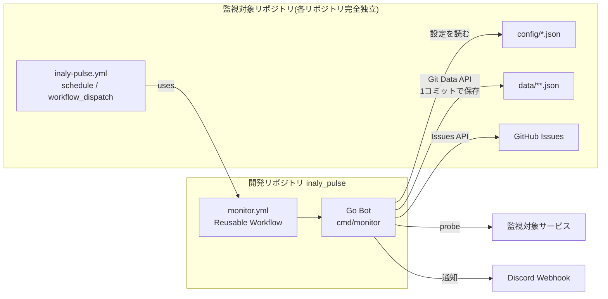
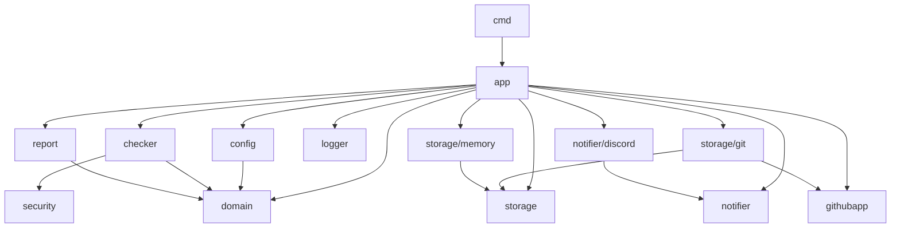
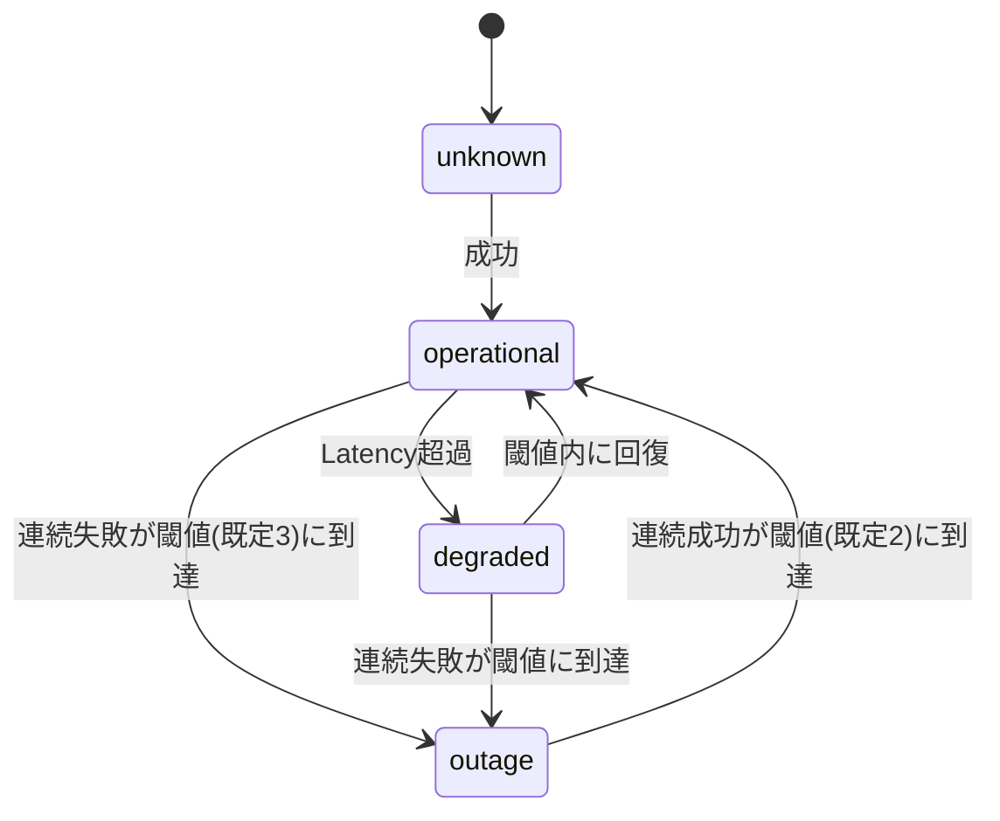
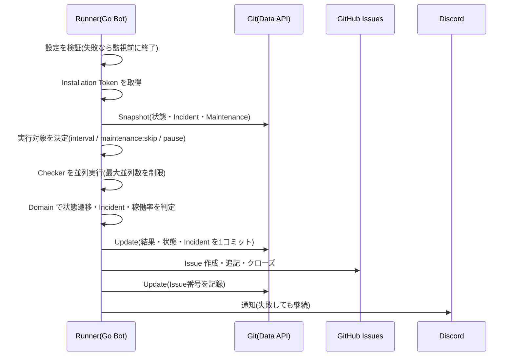

# アーキテクチャ設計(Phase 0 / Phase 1)

未確定事項(`00-requirements-and-open-questions.md` の Q番号)に依存する箇所は、その番号を併記する。

## 1. 全体構成



## 2. パッケージ依存関係

矢印は「依存する」を表す。**Domain 層は標準ライブラリ以外に依存しない。**



- `domain/*`(monitor, incident, maintenance, uptime)は GitHub API・Discord API・JSON形式を知らない。
- `storage` と `notifier` はインターフェースだけを持ち、実装(`storage/git`, `notifier/discord`)は別パッケージ。
- `app` が全体を組み立てる(依存の注入はここだけで行う)。
- 仕様7章の初期案から変えた点: `Checker` インターフェースを `internal/checker` に置いた(`Monitor` / `Result` は domain 側)。Domain が Checker 実装に依存しないため。

## 3. Domain Model(Phase 1 で実装済み)

| パッケージ | 型 | 内容 |
|---|---|---|
| `domain/monitor` | `Monitor`, `Spec`, `LatencyPolicy` | 監視対象の設定。方式固有の設定は `Spec` インターフェースで型安全に保持 |
| | `Result`, `Details`, `CheckError` | 1回の監視結果。方式固有の結果は `Details` で保持 |
| | `CheckStatus` | success / failure / timeout / unsupported / skipped |
| | `State` | unknown / operational / degraded / outage |
| `domain/incident` | `Incident`, `State`, `TrackerRef` | open / investigating / resolved。Issue は番号とURLのみ保持 |
| `domain/maintenance` | `Window`, `Scope`, `Origin`, `Mode`, `State` | global / monitor × scheduled / manual、skip / suppress(既定 suppress) |
| `domain/uptime` | (Phase 9) | Availability / Health / Coverage / Latency統計 |

状態の種類は混同しないよう、型を分けている(Check Result / Monitor State / Incident State / Maintenance State)。

### 状態遷移(確定部分のみ。Q2 の結論で変わる)



## 4. インターフェース

### Checker(`internal/checker`)

```go
type Checker interface {
    Type() monitor.Type
    Check(ctx context.Context, m monitor.Monitor) monitor.Result
}
```

監視対象の失敗は `Result` で返し、`error` は返さない。Bot 自身の内部エラーと区別するため。
`Registry` に登録することで方式を追加できる。設定検証の「Checker Type が登録済みか」も `Registry.Types()` で判定する。

### Storage(`internal/storage`)

Git の語彙を含まない抽象とした。

```go
type Repository interface {
    Snapshot(ctx context.Context) (Snapshot, error)
    Update(ctx context.Context, fn UpdateFunc) (Result, error)
}
```

- `Update` は最新状態を読み、`fn` の返した `ChangeSet` を **1コミット** で反映する。
- SHA 競合時は最新状態を再取得して `fn` を再実行する(再試行回数は実装が制限)。そのため `fn` は冪等でなければならない。
- 変更が無ければコミットを作らない(`Committed=false`)。成功していなければ必ず `error`。
- `storage/memory` を用意することで、GitHub なしでテストできる。

### Notifier(`internal/notifier`)

`Notify(ctx, Event) error`。`Event` は通知先に依存しない形で、重複防止用の `DedupeKey` を持つ。Q18 の結論で配送方式が決まる。

## 5. データ構造(JSON)

すべてのファイルに `schema_version` を持たせる。JSON Schema 化は Phase 2。

### 設計判断: カウンタは Git に保存する

Runner は毎回新しい環境のため、連続失敗数・連続成功数・連続Latency超過数はメモリに持てない。`monitor_states.json` に保存する。

```jsonc
// data/state/monitor_states.json
{
  "schema_version": 1,
  "updated_at": "2026-01-01T00:07:00Z",
  "monitors": {
    "example-http": {
      "state": "operational",
      "since": "2025-12-30T10:00:00Z",
      "consecutive_failures": 0,
      "consecutive_successes": 5,
      "consecutive_latency_breaches": 0,
      "last_check_at": "2026-01-01T00:07:00Z",
      "last_status": "success"
    }
  }
}
```

```jsonc
// data/history/2026/01/01.json  (日付単位で分割)
{
  "schema_version": 1,
  "date": "2026-01-01",
  "entries": [
    {
      "monitor_id": "example-http",
      "type": "http",
      "check_status": "success",
      "monitor_state": "operational",   // 稼働率の分子・分母の判定に使う
      "maintenance": null,              // "suppress" / "skip" / null。稼働率の分母から除外する
      "started_at": "2026-01-01T00:07:00Z",
      "duration_ms": 182,
      "error": null,
      "details": {}                     // 方式固有。認証情報・レスポンス本文は保存しない
    }
  ]
}
```

```jsonc
// data/incidents/active.json
{
  "schema_version": 1,
  "incidents": [
    {
      "id": "inc-example-http-20260101T000700Z",   // Q13 の結論で形式を確定
      "monitor_id": "example-http",
      "state": "open",
      "opened_at": "2026-01-01T00:07:00Z",
      "last_update_at": "2026-01-01T00:37:00Z",
      "tracker": { "number": 12, "url": "https://github.com/.../issues/12", "sync": "synced" }
    }
  ]
}
```

解決済みの Incident は `data/incidents/archive/YYYY/MM/<incident_id>.json` に移す(ディレクトリ形式は提案。保持期間は Q12)。

```jsonc
// data/maintenance/schedules.json
{
  "schema_version": 1,
  "windows": [
    {
      "id": "mt-20260101-db",
      "scope": "monitor",              // global / monitor
      "monitor_id": "example-http",
      "origin": "scheduled",           // scheduled / manual
      "mode": "suppress",              // 既定 suppress
      "starts_at": "2026-01-02T00:00:00Z",
      "ends_at": "2026-01-02T02:00:00Z"
    }
  ]
}
```

`current.json`(最新の監視結果)、`metadata.json`(退役 Monitor ID など。Q13)、`reports/daily|monthly/` も同様に `schema_version` を持つ。

### 設定ファイル

`config/monitors.json` と `config/settings.json` は仕様14章の例のとおり。監視方式ごとの固有設定は、方式名のキー配下に置く案とする(例: `"http": { "method": "GET", "expect_status": [200] }`)。詳細は Phase 2 で確定する。

## 6. 1回の実行の流れ



### 設計判断: 外部副作用の前に Git へ記録する

Git が正本で、Issue は表示手段(仕様10.3)。重複 Issue を防ぐため次の順序にする。

1. Incident ID を決めて Git にコミットする(Issue は `sync: pending`)。
2. Issue 本文に `<!-- inaly-pulse:incident=<ID> -->` を埋め込み、作成前にこのマーカーで既存 Issue を検索する。
3. 作成後、Issue 番号を Git にコミットする。

2と3の間で失敗しても、再実行時にマーカーで検出して対応付けを復元できる。

### 設計判断: 設定と状態の読み取り元

- 設定(`config/`)は Checkout したワーキングツリーから読む(Workflow を起動したコミットの設定で実行される)。
- 状態(`data/`)は `Repository.Snapshot` で最新を読む(Checkout 後に他の更新が入っていても古い状態で上書きしない)。

## 7. GitHub Actions の構成(Phase 10 で確定)

- 監視対象側: `schedule`(`7,22,37,52 * * * *`)と `workflow_dispatch` のみを持ち、Reusable Workflow を呼ぶだけ。
- 開発リポジトリ側 `monitor.yml`: `on: workflow_call`。入力に App ID(Variables はそのままでは渡らないため `inputs` で受け取る)、Secrets に秘密鍵と Webhook URL。
- Installation Token は Bot が自前で生成する(JWT 生成を自前実装し、サードパーティ Action に秘密鍵を渡さない)。
- `concurrency` は `group: inaly-pulse-<リポジトリ>`、`cancel-in-progress: false`。FIFO は保証されないため、Git 更新の競合は Storage 側の再試行で吸収する。
- `permissions` は最小(`contents: read`)。データの書き込みは GitHub App のトークンで行う。
- 使用する Action は Commit SHA で固定する。
- Secret名は Q1、Bot 本体の Checkout 方法は Q5、保存先ブランチは Q4 に依存する。

## 8. セキュリティ上の整理

仕様16章に対して、設計時点で必要と考える対策。

| # | 内容 | 対応方針 |
|---|---|---|
| S1 | DNS Rebinding | 名前解決後ではなく、**接続時**(`net.Dialer.Control`)に接続先IPを検証する。事前検証だけでは不十分 |
| S2 | Redirect | `CheckRedirect` で毎回URLを再検証し、リダイレクト回数に上限を設ける |
| S3 | IP判定の抜け | IPv4-mapped IPv6 の正規化、CGNAT、ULA、未指定、マルチキャストなど(Q19) |
| S4 | プロキシ環境変数 | `http.Transport` の `Proxy` を無効にし、環境変数の `HTTP_PROXY` で検証を迂回されないようにする |
| S5 | 認証情報 | monitors.json に直接書かせない(Q11)。ログ・結果JSONには保存しない |
| S6 | レスポンス | 本文検証では読み取りサイズに上限を設ける(仕様には Request Body の上限のみ。Response の上限を追加提案) |
| S7 | 通知・Issue への注入 | 外部由来の文字列(エラー、名前)はエスケープする。Discord は `allowed_mentions` を空にして `@everyone` を無効化する |
| S8 | Webhook URL | 保存・ログ出力しない。`https` かつ Discord のホストであることを検証する(提案) |
| S9 | 手動実行 | `workflow_dispatch` の入力は監視対象 ID のみ。任意のURL・IPは受け付けない |
| S10 | コマンド(将来) | 投稿者の権限(リポジトリへの書き込み権限など)を確認してから実行する |

DNS 監視は Resolver(8.8.8.8 など)にのみ接続し、DNS解決結果への接続は行わない。TCP / HTTP / Ping は解決後のIPを S1 の対象にする。

## 9. 実装順序

仕様21章の Phase 1〜11 をそのまま採用する。1点だけ補足する。

- Phase 3(Storage)の Git Data API 呼び出しには HTTP クライアントが必要なため、`githubapp/client` の最小実装を Phase 3 で先に作る。JWT・Installation Token(Phase 4)は、Phase 3 では `httptest` によるモックで代替してテストする。

各 Phase の前に、ブロックとなる Q を確認する。

| Phase | 先に確認する Q |
|---|---|
| 2 Configuration | Q3, Q13, Q16 |
| 3 Storage | Q4, Q12 |
| 4 GitHub App | (なし) |
| 5 Monitoring Engine | Q9, Q10, Q11, Q19 |
| 6 Incident | Q2, Q6, Q7, Q15 |
| 7 Maintenance | Q8, Q14, Q17 |
| 8 Notifications | Q18 |
| 9 Reports | Q3, Q12 |
| 10 Actions | Q1, Q4, Q5, Q11 |
